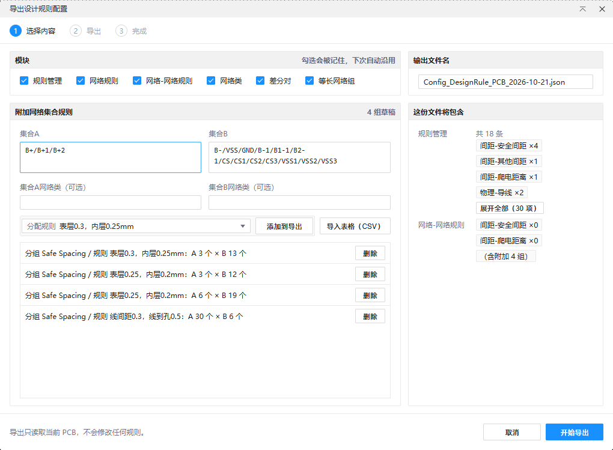
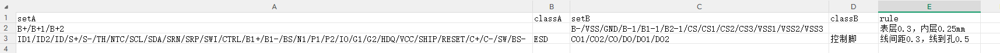
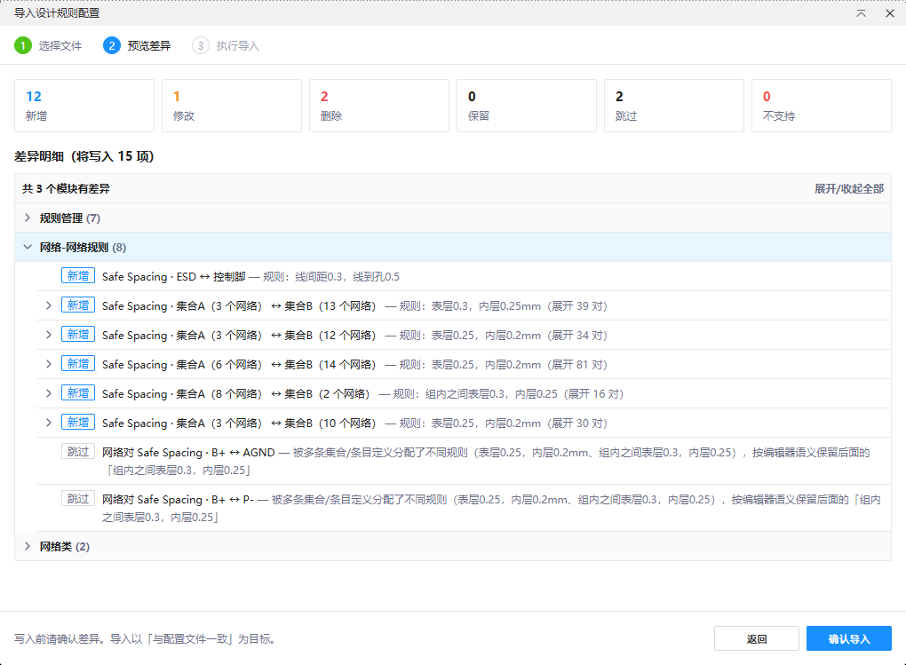
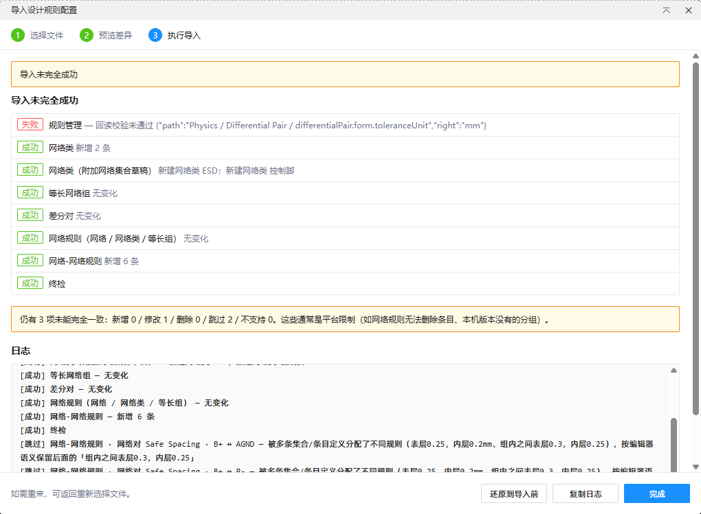

# 规则配置管理

把一块 PCB 上调好的设计规则，快速搬到另一块 PCB。

你可以在标准板上维护一份团队规则，新项目直接导入；也可以把电源、采样、控制脚等网络按集合整理成规则，不用在对话框里一条条点。导入前会先告诉你哪些内容会新增、修改或跳过，导入后还能一键还原。


## 什么时候会用

- 新项目沿用老项目的安全间距、导线宽度、平面规则。
- 多人协作时，把统一规则发给团队成员，避免每块板各改一套。
- 客户给出网络清单或间距要求时，快速批量建立网络到网络的规则。
- 导入后想检查、回退，不希望规则被悄悄改乱。

## 三个核心功能

### 1. 导出设计规则配置

打开 PCB 后，从顶部菜单「规则配置 → 导出设计规则配置」进入。勾选要带走的模块，填写文件名，就能得到一个 JSON 文件。

可导出内容包括：

- 规则管理：安全间距、导线、平面、阻焊/钢网等规则值。
- 网络规则：某个网络单独分配的规则。
- 网络-网络规则：两个网络之间更严格的间距或电气规则。
- 网络类、差分对、等长网络组。

导出弹窗左侧还支持「附加网络集合规则」。你可以只填一组网络，选一个规则名，快速为这些网络分配规则；也可以填两组网络，再选一个规则名，把它们整理成两组之间的集合规则。即使这些网络当前板上还没有，也能先写进 JSON，作为团队模板保存。



### 2. 批量添加网络集合规则

如果一组规则涉及很多网络，可以用 CSV 批量添加。模板表头是：

```csv
setA,classA,setB,classB,rule
```

- `setA` / `setB`：网络集合，网络名之间用 `/` 分隔。
- `classA` / `classB`：可选。填了网络类名，导入时会把这些网络放进对应网络类。
- `rule`：要分配给这组网络的规则名。

一行就是一条集合规则。导入时会和当前 PCB 的实际网络匹配；没有的网络自动跳过，并在日志里汇总。



### 3. 导入前先看差异

在目标 PCB 上选择「导入设计规则配置」，选择 JSON 文件后先进入差异预览。你会看到哪些是新增、哪些会被修改、哪些因为没有对应网络会跳过。确认无误后再导入。

导入完成后可以查看结果和日志。如果发现导错文件或选错了板，可以直接点「还原到导入前」，回到导入前的状态。





## 几条实用说明

- 网络名匹配忽略大小写，例如 `GND` 和 `gnd` 会被视为同一个网络。
- 差分对只要有一端网络在目标板上不存在，整对不导入。
- 网络类、差分对、等长网络组不会删除目标板上已有的内容，只做新增或成员迁移。
- 有些规则分组和普通网络条目受平台接口限制，无法删除；预览和日志会说明，不会悄悄覆盖成错误数据。
- 插件只处理规则和关系，不会移动、修改 PCB 上的图形对象。

## 安装

1. 打开嘉立创 EDA 专业版。
2. 进入「设置 → 扩展 → 扩展管理」。
3. 安装本地扩展，选择 `.eext` 文件。
4. 启用并刷新编辑器，看到顶部菜单「规则配置」即可使用。

支持嘉立创 EDA 专业版 V3.2 及以上版本；界面支持简体中文和英文。
